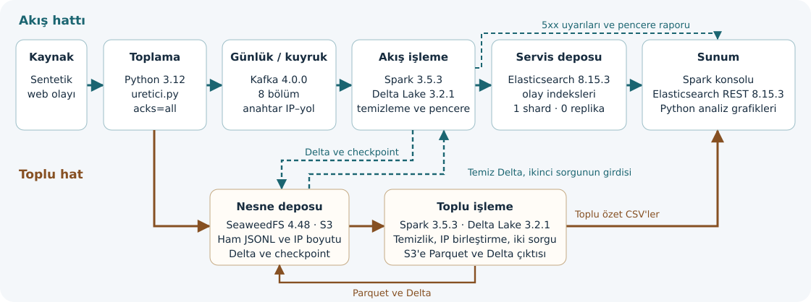

# BSM461 · Web sunucu log analizi

**Şube 1A · Grup B201210555 · Koray Temizkan, Yüksel, Ali**

E-ticaret logları Kafka → Spark Structured Streaming → Delta ve Elasticsearch hattından geçer. Akış, 5xx hata oranı eşiğini ve rota başına ortalama yanıt süresini izler. Toplu iş, SeaweedFS’teki JSONL dosyalarını temizler, IP boyutuyla birleştirir, Parquet ve Delta’ya yazar. Son iki sorgu Türkiye saatine göre trafik yoğunluğunu ve en çok 5xx üreten rotaları gösterir.



Grubun senaryosu ortalama 1.500, tepede 12.000 olay/s, en fazla 30 saniyede uyarı, 10 dakikaya kadar %1 geç veri, en fazla %1 sayım kaybı, 30 gün ham saklama ve p99 ≤ 2.000 ms hedefler. Bu hedefler üretim tasarımına aittir. Deneylerin veri boyutu ve koşulları ölçüm tablosundadır. [Senaryo kartı](kanit/senaryo.txt) · [Ölçümler](kanit/olcumler.csv)

## 1. Linux Mint üzerinde kurulum

Docker Engine ve Compose eklentisi gerekir. Kit, Elasticsearch ile Docker için en az 7 GB bellek ayırmayı önerir. İlk çalıştırmada konteyner imajları ve Spark bağımlılıkları indirilir. Bu makinede Docker komutları için `sudo` kullanılır.

```bash
git clone https://github.com/KorayTemizkan/BSM461_Proje_1A_B201210555.git
cd BSM461_Proje_1A_B201210555
sudo docker compose build araclar
sudo docker compose --profile arama up -d --no-build
sudo docker compose ps -a
sudo ./dogrula.sh --tam
```

`s3-kur` tamamlanınca `ham`, `islenmis` ve `tablolar` kovaları hazırdır. Projenin Compose uyarlaması S3 sağlık kontrolünü Docker ağındaki `s3:9333` adresine yapar. Kafka host portu 9092, S3 portu 8333, Elasticsearch portu 9200, Spark UI portu 4040’tır. Spark UI iş çalışırken görünür. Kibana isteğe bağlı `pano` profiliyle çalışır. Demo, Elasticsearch REST API’si ve Spark konsolunu kullanır.

## 2. Akışı çalıştır

Her bağımsız denemeye yeni bir deney adı ve konu verin. İki terminalde de aynı `DENEY` değerini kullanın.

```bash
DENEY=demo-01
sudo docker compose exec -T kafka /opt/kafka/bin/kafka-topics.sh \
  --bootstrap-server localhost:9092 --create --if-not-exists \
  --topic "web-loglari-$DENEY" --partitions 8 --replication-factor 1

sudo docker compose exec spark spark-submit is/akis_iskelet.py \
  --deney "$DENEY" --konu "web-loglari-$DENEY" \
  --es http://elasticsearch:9200 --goster
```

İkinci terminalde log üretin. `--sure` her turda yeni bir olay grubu üretir. Üreticinin toplamı uygulama tarafından eklenen tekrarları içermez.

```bash
DENEY=demo-01
sudo docker compose exec -T araclar python araclar/uretici.py \
  --grup B201210555 --sablon log --konu "web-loglari-$DENEY" \
  --kafka-anahtar ip-yol --hiz 50 --sure 10
```

İlk Spark komutunu `Ctrl+C` ile durdurduktan sonra aşağıdaki komut aynı checkpoint’ten devam eder, bekleyen veriyi işler, kaydedilen pencere sayımını gösterir ve çıkar. Sadece kayıtlı sonuçları okumak için `--rapor` kullanın.

```bash
sudo docker compose exec -T spark spark-submit is/akis_iskelet.py \
  --deney "$DENEY" --konu "web-loglari-$DENEY" \
  --es http://elasticsearch:9200 --bekleyeni-isle
```

Aynı deney, temiz olayları `s3a://islenmis/akis/log/<deney>/temiz`, pencere güncellemelerini `.../metrik` ve sorgu durumlarını `.../checkpoint` altında tutar. Bölüm içi ofset sırası, watermark ve hedef yazma garantileri raporda açıklanır. [Akış raporu](belgeler/rapor.md#8-akış-hattı-z8)

Elasticsearch indeksinde 5xx olay araması ve rota toplaması için aşağıdaki istekleri çalıştırın.

```bash
DENEY=demo-01
ES="http://localhost:9200/web-loglari-$DENEY"

curl -fsS "$ES/_count?pretty"
curl -fsS "$ES/_search?pretty" -H 'Content-Type: application/json' -d '
{
  "size": 5,
  "sort": [{"olay_zamani": "desc"}],
  "query": {"range": {"durum": {"gte": 500, "lte": 599}}}
}'
curl -fsS "$ES/_search?pretty" -H 'Content-Type: application/json' -d '
{
  "size": 0,
  "query": {"range": {"durum": {"gte": 500, "lte": 599}}},
  "aggs": {"yollar": {"terms": {"field": "yol", "size": 5}}}
}'
```

### Kontrollü geç veri ve yeniden başlatma

Önce bu pilot için yeni bir konu açın. Her Spark çağrısı kapandıktan sonra aynı deney kimliğiyle devam edin. Üretici her evrede broker onayını sayar. Spark çıktısında birikimli temiz ve pencere sayıları görünür.

```bash
DENEY=gec-pilot-01
sudo docker compose exec -T kafka /opt/kafka/bin/kafka-topics.sh \
  --bootstrap-server localhost:9092 --create --if-not-exists \
  --topic "web-loglari-$DENEY" --partitions 8 --replication-factor 1

pilot_gonder() {
  sudo docker compose exec -T araclar python analiz/akis_pilot_veri.py "$1" \
    --kafka kafka:29092 --konu "web-loglari-$DENEY"
}
pilot_oku() {
  sudo docker compose exec -T spark spark-submit is/akis_iskelet.py \
    --deney "$DENEY" --konu "web-loglari-$DENEY" --bekleyeni-isle
}

pilot_gonder 1 && pilot_oku && pilot_oku && \
  pilot_gonder 2 && pilot_oku && pilot_gonder 3 && pilot_oku
```

Yerel pilotta sırasıyla 100, 100, 200 ve 210 temiz olay ile aynı pencere toplamları ölçüldü. Son evre sınır dışı geç veriyle stres testidir. [Yerel Kafka ve Spark çıktısı](kanit/akis-pilot.txt)

## 3. Toplu hattı çalıştır

Aşağıdaki üretici komutu yeni bir kurulum veya atılabilir ham veri içindir. `--toplu` üretimi varsayılan olarak `s3://ham/log/` altındaki eski logları siler. Toplu iş de belirtilen Parquet ve Delta hedefleri üzerine yazar. Mevcut ölçüm ya da arşivi korumak için aşağıdaki yerel pilot yolunu kullanın. `--ekle` ham veriyi korur ve sonraki koşunun veri büyüklüğünü değiştirir.

```bash
sudo docker compose exec -T araclar python araclar/uretici.py \
  --grup B201210555 --sablon log --toplu 10000 --gun 7

sudo docker compose exec -T spark spark-submit is/toplu_log.py
```

Ham JSONL `s3://ham/log/tarih=…/`, IP boyutu `s3://ham/boyut/log/ip_bilgisi.csv` altındadır. İki toplu hedef `s3a://islenmis/toplu-log/` ve `s3a://tablolar/toplu-log` yoluna yerel tarihe göre bölümlenir. `is/toplu_log.py --analiz-cikti <dizin>` ayrıca iki küçük sonuç CSV’si ve tarih filtreli Parquet planı üretir. Z2, Z4, Z5 ve Z7 deney komutları kanıtların ve Yüksel’in rapor bölümlerinin başındadır. [Yüksel’in deneyleri](kanit/yuksel/BSM461-Yuksel-Rapor-Bolumleri.md)

## 4. Tarihi sabitlenmiş pilotu ve grafikleri yeniden üret

Bu yol Docker verisinden ayrı bir dizin açar. Yerel Spark koşusu için Java 17 ve Python gerekir. `PYSPARK_PYTHON` Spark’ın sanal ortam Python’unu kullanmasını sağlar.

```bash
python3 -m venv /tmp/bsm461-venv
source /tmp/bsm461-venv/bin/activate
python -m pip install pyspark==3.5.3 matplotlib

PILOT=$(mktemp -d)/pilot
python analiz/pilot_veri.py "$PILOT" --bitis 2026-11-18
PYSPARK_PYTHON=python spark-submit --master 'local[2]' \
  --repositories https://repo.maven.apache.org/maven2 \
  --packages io.delta:delta-spark_2.12:3.2.1 \
  --conf spark.sql.extensions=io.delta.sql.DeltaSparkSessionExtension \
  --conf spark.sql.catalog.spark_catalog=org.apache.spark.sql.delta.catalog.DeltaCatalog \
  --conf spark.sql.shuffle.partitions=8 \
  --conf spark.databricks.delta.snapshotPartitions=4 \
  is/toplu_log.py --ham "$PILOT/ham/log" \
  --ip-bilgisi "$PILOT/ham/boyut/log/ip_bilgisi.csv" \
  --parquet "$PILOT/parquet" --delta "$PILOT/delta" --analiz-cikti "$PILOT/sonuc"

python analiz/grafikler.py "$PILOT/sonuc" "$PILOT/sonuc"
python analiz/kapasite.py
```

Kalite ayrımı `$PILOT/veri-kalitesi.csv`, sonuçlar ve iki PNG `$PILOT/sonuc` altındadır. Pilot, Yüksel’in deneyiyle aynı UTC bitiş gününü ve grup tohumunu kullanır.

## 5. Rapor, sunum ve kanıtlar

- [Rapor PDF](belgeler/BSM461_Proje_1A_B201210555.pdf) · [Düzenlenebilir rapor](belgeler/rapor.md)
- [Sunum PDF](belgeler/BSM461_Proje_1A_B201210555_sunum.pdf) · [Düzenlenebilir sunum](belgeler/sunum.md)
- [Ölçümler](kanit/olcumler.csv) · [Kapasite hesabı](kanit/kapasite.csv) · [Kırılma kanıtı](kanit/kirilma-deneyi.txt) · [Spark planı](kanit/explain-toplu.txt) · [Akış pilotu](kanit/akis-pilot.csv)
- [Veri kalitesi](kanit/veri-kalitesi.csv) · [Saatlik trafik](kanit/saatlik-trafik.png) · [Rota başına 5xx](kanit/rota-5xx.png)

PDF’leri güncellemek için `python -m pip install Markdown weasyprint` ve `python belgeler/pdf_uret.py` çalıştırın. Kapakta teslim commit’i ve katkı sayfasında üç üyenin grup onayı teslim sırasında tamamlanır.

Yerel geliştirmeyi durdurmak için `sudo docker compose stop` kullanın. Kit tek Kafka brokerı, tek SeaweedFS düğümü, yerel Spark ve güvenliği kapalı tek Elasticsearch düğümü çalıştırır. Gerçek istemci kayıtlarını bu kurulumda kullanmayın.
