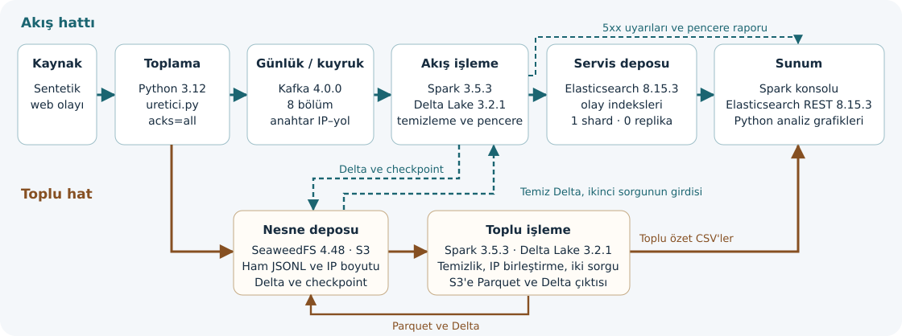
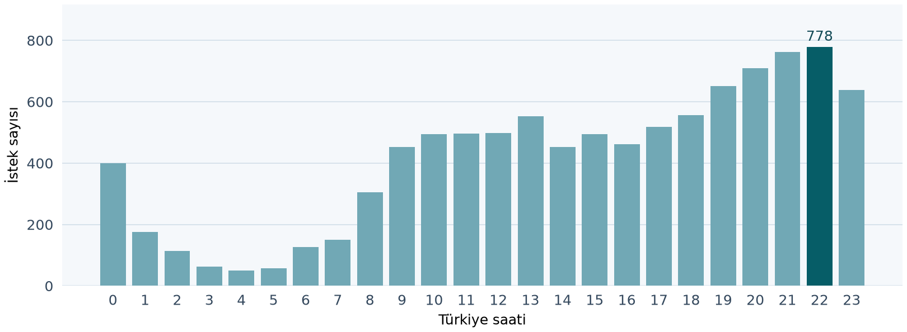
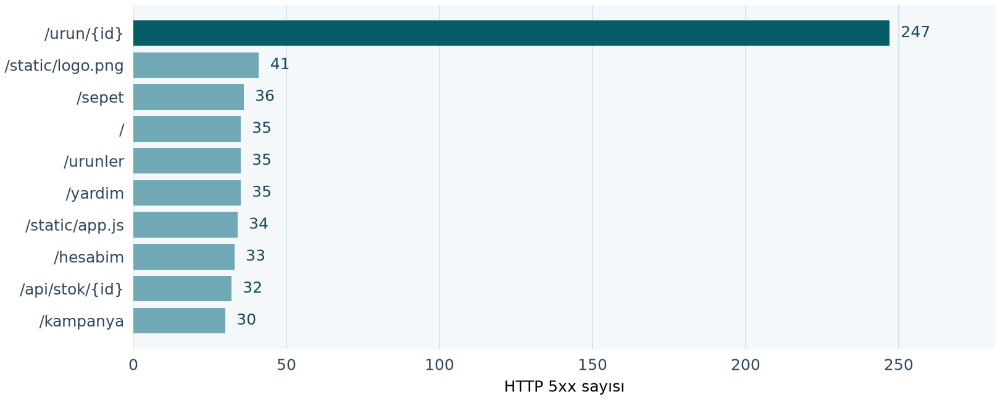

# BSM461 Büyük Veriye Giriş

## Web sunucu log analizi

**Şube 1A · Grup B201210555**

**Üyeler**  
Koray Temizkan · Yüksel · Ali

**Senaryo**  
Bir e-ticaret sitesi saniyede ortalama 1.500, tepe saatte 12.000 istek alır. Akış uyarısı en fazla 30 saniyede çıkmalıdır. Olayların %1’i en fazla 10 dakika geç gelir. Geçlikten kaynaklanan sayım kaybı en fazla %1, ham veri saklama süresi 30 gün ve servis sorgusu p99 sınırı 2.000 ms’dir. [Grubun senaryo kartı](../kanit/senaryo.txt)

**Depo**  
[BSM461_Proje_1A_B201210555](https://github.com/KorayTemizkan/BSM461_Proje_1A_B201210555)

**Teslim commit’i**  
Grup onayı ve `teslim` etiketi sonrasında doldurulacak.

<!-- sayfa -->

## 2. Özet

E-ticaret web loglarını iki koldan işledik. Akışta Kafka’dan gelen logları Spark ile temizleyip Delta’ya yazdık, Elasticsearch’e indeksledik ve 20 saniyelik pencerelerde 5xx oranı ile rota başına ortalama yanıt süresini hesapladık. Toplu hatta S3’teki JSONL verisini temizleyip IP boyutuyla birleştirdik. Parquet ve Delta çıktılarından Türkiye saatine göre trafik yoğunluğunu ve en fazla 5xx üreten rotaları inceledik.

1. Canlı üzerine yazma kesintisinden sonra Delta sürüm 0’daki 1.000 satırı korudu. Normal Parquet hedefi Spark’ta şema çıkarımı hatası verdi.
2. 50 sentetik `503` olayının Kafka onayından ilk konsol uyarısına 21,863 saniye geçti. Bu düşük hacimli tek koşuda 30 saniyelik hedef karşılandı.
3. Yedi günlük pilotta en yoğun saat 778 istekle 22.00–22.59 oldu. `/urun/{id}` 247 hatayla 5xx adedi sıralamasında ilk sıradaydı.

Yerel deneyler ve senaryo hesabı, sırasıyla prototipin davranışını ve üretim ölçeğini gösterir. Girdiler ve ölçüm bağlamları ortak CSV’de yer alır. [Ölçüm tablosu](../kanit/olcumler.csv)

<!-- sayfa -->

## 3. Mimari ve garanti tablosu (Z0)



**Şekil 1.** Docker Compose üzerinde akış, servis ve bağımsız ham dosya üretiminden başlayan toplu hat. Kesikli oklar akışın Delta ve konsol yan çıkışlarını gösterir.

Sentetik kaynak aynı grup koduyla iki kipte çalışır. Toplu kip S3’e doğrudan ham JSONL ve IP boyutu yazar. Akış kipi Kafka’ya yazar. Spark’ın akış temizleme sorgusu Delta’ya ve seçiliyse Elasticsearch’e olay yazar. Pencere sorgusu temiz Delta tablosunu tüketir. S3’teki ham JSONL yolunu toplu üretici besler. Kafka’dan S3’e kesintisiz ham arşivleme üretim tasarımında ayrıca kurulmalıdır. [Compose](../docker-compose.yml) · [Üretici](../araclar/uretici.py) · [Akış](../is/akis_iskelet.py)

**Tablo 1.** Ok bazında kopya, sıra ve kesinti davranışı.

| Ok | Kitte kopya ve sıra | Ağ bölünmesi veya erişim kaybı | Üretim kararı |
|---|---|---|---|
| Kaynak → Python üretici | Olay süreç belleğinde. Genel sıra garantisi yok. | Süreç kapanırsa gönderilmemiş olay kalıcı olmaz. | Yerel kalıcı kuyruk ve kaynak olay kimliği. |
| Üretici → Kafka | Bir broker ve bir kopya. Sıra bölüm ofseti içinde. | `acks=all` mevcut ISR’yi onaylatır. Tek broker erişilemezse yazım kesilir. | Üç broker, üç kopya, `min.insync.replicas=2`, TLS ve kimlik doğrulama. |
| Kafka → Spark temizleme | Kafka tek kopya. Spark bölüm ofsetini izler. Spark çıktısında küresel sıra yok. | Broker yokken okuma durur veya hata verir. Ofset artık mevcut değilse `failOnDataLoss=true` işi durdurur. | Kayıp ofset alarmı, tüketim gecikmesi takibi ve yeniden okuma için saklama payı. |
| Üretici → SeaweedFS ham depo | Tek düğüm. JSONL içinde yazım sırası var, dosyalar arasında garanti yok. | Başarılı `PUT` alan nesne görünür. Çok dosyalı üretim yarıda kalabilir. | Çoğaltılmış nesne deposu, yazım kontrolü ve tamamlanmış giriş manifesti. |
| Ham S3 → Spark toplu | Kaynak nesne tek kopya. Spark dosyalar arasında sıra vermez. | Okuma başarısız olursa giriş düzeldikten sonra iş yeniden çalıştırılır. | Sabit girdi manifesti ve yeniden deneme. |
| Spark toplu → S3 Parquet/Delta | Tek depolama kopyası. Delta commit sırası var. Parquet satır ve dosya sırası belirsiz. | Normal Parquet üzerine yazma yarım kalabilir. Önceki Delta commit’i, depo erişimi geri gelince okunabilir. | Sürüm yayımlama için Delta. Normal Parquet tüketicileri için değişmez hedef ve manifest. |
| Spark ↔ S3 Delta ve checkpoint | Tek depolama kopyası. Delta commit ve sorgu mikro-yığın kimliği sıralı. | Delta/checkpoint erişimi kesilince Spark ilerleyemez. Depo ve aynı checkpoint sağlamsa tekrar yürütür. | Dayanıklı depolama ve her sorguya ayrı checkpoint. Her hedef için idempotent yazma. |
| Spark → Elasticsearch | Bir birincil shard, sıfır replika. Belge yazımında genel sıra garantisi yok. | Bulk çağrısı hata verirse yığın yeniden denenebilir. Delta commit’i daha önce tamamlanmış olabilir. | Replikalı indeks, kararlı `_id` ile yeniden yazım, toplu yazma hatası ve gecikme alarmı. |
| Spark → konsol | Kalıcı uyarı deposu yok. Pencere için birden çok güncelleme çıkabilir. | Süreç veya çıktı istemcisi kesilirse uyarı görünürlüğü kaybolabilir. | Pencere kimliğiyle idempotent, dayanıklı bildirim kuyruğu. |
| Elasticsearch → REST | REST yanıtı tek shard’dan gelir. Sorgu sırası istekte belirlenir. | ES erişilemezse sorgu başarısız olur. | Zaman aşımı ve kullanıcıya görünür hata. |
| Spark toplu özet → grafik | CSV yerel diskte tek kopyadır. Sıra sorguda belirlenir. | Tamamlanmış CSV üzerinden çevrimdışı grafik üretilebilir. | CSV ve şekiller birlikte sürümlenir. |

Spark Compose’da yerel kipte çalışır. Kafka, SeaweedFS ve Elasticsearch aynı bilgisayarda tek düğümdür. Geliştirme ayarları Kafka’da PLAINTEXT, Elasticsearch’te güvenlik kapalıdır. Disk, ağ ve süreç arızaları bağımsız hata alanlarına dağıtılmamıştır. [Kafka tasarımı](https://kafka.apache.org/40/design/design/) · [Delta akış işlemleri](https://docs.delta.io/delta-streaming/)

## 4. Ölçek ve eşik kararı (Z1)

Kafka örneğindeki 100 JSON değeri UTF-8 olarak toplam 17.647 bayttır. Olay başına ortalama **176,47 bayt** ölçtük. En küçük olay 144, en büyük olay 197 bayttır. Satır sonu dahil JSONL depolama karşılığı 177,47 bayt/olaydır. 30 günlük ham hacim `ortalama olay/s × 86.400 s/gün × 30 gün × 177,47 bayt/olay` ile hesaplandı. Parquet tahmini, Yüksel’in aynı 9.959 temiz satır için ölçtüğü Zstandard/JSON oranı `150.036 / 1.852.908 ≈ %8,10` ile ölçeklendi. [Kafka örneği](../kanit/log-ornekleri.jsonl) · [Kapasite hesabı](../kanit/kapasite.csv) · [Biçim ölçümü](../kanit/yuksel/BSM461-Yuksel-Rapor-Bolumleri.md)

**Tablo 2.** Ortalama hızdan saklama, sekiz kat tepe hızından giriş hesabı. GB ve MB ondalıktır. Çoğaltma, Kafka/HTTP ek yükü, checkpoint, indeks ve geçici dosyalar hariçtir.

| Ölçek | Ortalama / tepe (olay/s) | Olay/gün | 30 gün ham JSONL | 30 gün Zstd Parquet tahmini | Tepede JSON (MB/s) |
|---|---:|---:|---:|---:|---:|
| 1× | 1.500 / 12.000 | 129,6 milyon | 690,00 GB | 55,87 GB | 2,118 |
| 10× | 15.000 / 120.000 | 1,296 milyar | 6,90 TB | 558,72 GB | 21,176 |
| 100× | 150.000 / 1.200.000 | 12,96 milyar | 69,00 TB | 5,59 TB | 211,764 |

Arşivi ortalama hızla, Kafka ve Spark tüketim kapasitesini 30 saniye uyarı hedefi nedeniyle tepe hızla planlarız. Pilot gününde proje diskinde yaklaşık 183 GB kullanılabilir alan vardı. 690 GB ham saklama gereksinimi bu alanı aşıyor. Zstandard tahmini pilot temiz verisinden gelir. Arşive dönüştürülecek ham kayıtların sütun dağılımı, dosya boyutu ve veri kaybı olmadan yeniden okunabilirliği üretim verisinde doğrulanmalıdır. [Yerel ortam ölçümü](../kanit/pilot-ortam.txt)

İlk öngörülen darboğaz Spark’ın Kafka okuması. Tepe yük beş saniyede 60.000 olay getirir. Mevcut `maxOffsetsPerTrigger=20000`, beş saniyelik hedef ritminde yaklaşık 4.000 olay/s okuma bütçesi verir. Bu bütçe sağlanırken tepede her beş saniyede yaklaşık 40.000 olay fark birikir. Uyarı kaydında bazı yığınlar beş saniyeyi de aştı. Bu, yapılandırma hesabı ve darboğaz hipotezidir. Bileşenlerin gerçek sürdürülebilir tepe hızını ayrı yük testi belirler. H1 eşik tablosu sağlanan dosyalarda bulunmadığı için karar, ölçülen disk eşiği ve kodun okuma bütçesiyle temellendirildi. [Akış yapılandırması](../is/akis_iskelet.py) · [Uyarı günlüğü](../kanit/uyari-akis.log)

- **1×** için replikalı Kafka, ayrı Spark yürütücüleri, çoğaltılmış nesne deposu ve Elasticsearch öneriyoruz. Kafka’da tepeyi emen kuyruk, Spark’ta 30 saniye hedefi için geriden gelen ofsetleri eritme payı gerekir.
- **10×** için Kafka bölüm sayısı ve Spark paralelliği ölçülen bölüm yüküne göre artırılır. Arşiv ayrı nesne deposunda, Elastic indeksleri zaman bazında döndürülür. Toplu iş ile akış ayrı kaynak havuzlarına alınır.
- **100×** için birden çok broker ve hata alanı, ayrıştırılmış işlem kümeleri ve bağımsız servis kapasitesi gerekir. 211,764 MB/s yalnız veri gövdesidir. Varsayımsal 1 Gbit/s bağlantının 125 MB/s teorik sınırını bile aşar. Bölüm, disk ve ağ kapasitesi sıkıştırma ve replikasyon dahil ölçülür.

## 5. Depolama (Z2, Z4, Z7)

### Dosya biçimi ve nesne düzeni

Yüksel aynı 9.959 temiz satırı, her seçenekte tek dosya olacak şekilde yazdı. Her biçimde aynı 5xx rota sorgusu kullanıldı. Bir ısınma sonrası üç Spark `collect()` süresi alındı. Bütün biçimlerde sonuç eşleşti. [Yüksel’in ölçümleri](../kanit/yuksel/BSM461-Yuksel-Rapor-Bolumleri.md)

**Tablo 3.** Aynı veri ve sorguda biçim karşılaştırması.

| Biçim | Dosya boyutu (bayt) | Ortalama sorgu (ms) |
|---|---:|---:|
| Sıkıştırılmamış JSON | 1.852.908 | 63,27 |
| Parquet Snappy | 194.160 | 50,43 |
| Parquet Zstandard | 150.036 | 48,67 |
| Parquet Gzip | 158.596 | 55,63 |

Bu pilotta Zstandard en az alanı kullandı. Ana toplu iş Parquet kodeğini Spark yapılandırmasına bırakır. Üretimde Zstandard seçimi daha büyük örneklem ve yazma maliyeti ölçümüyle teyit edilmelidir. Ham dosyalar `s3://ham/log/tarih=…/` altında, IP boyutu `s3://ham/boyut/log/ip_bilgisi.csv` yolunda durur. İşlenmiş Parquet `s3a://islenmis/toplu-log/`, Delta `s3a://tablolar/toplu-log` yoluna Türkiye saatine göre tarih sütunuyla bölümlenir.

Yüksel, aynı Parquet içeriğini tarihe göre yeniden dağıtarak 64 dosyayı 8 dosyaya indirdi. 387.674 baytlık düzen 217.743 bayta indi. Ortalama sorgu süresi 62,56 ms’den 61,56 ms’ye inerken ortanca 58,2 ms’den 62,1 ms’ye çıktı. Veri ve sorgu sonuçları aynıydı. Yayımlama hedefi olarak Delta kullanmak, çok dosyalı Parquet üzerine yazımının kesinti riskini azaltır. [Dosya performansı](../kanit/yuksel/spark-performans.txt) · [Canlı kesinti](../kanit/yuksel/delta-parquet-canli-kesinti.txt)

### Delta tablo biçimi

Bir Delta deney tablosunda belirli bir güne ait 1.328 satır silindi. `versionAsOf=0` 9.959 satırı, güncel sürüm 1 ise 8.631 satırı döndürdü. Ayrı bir çalışmada kasıtlı görev hatası sonrası `DESCRIBE HISTORY` yalnız ilk commit’i gösterdi ve 9.959 satır hâlâ okunabildi. Canlı terminal kesintisindeki sonuç Bölüm 11’de inceleniyor. [Zaman yolculuğu](../kanit/yuksel/delta-zaman-yolculugu.txt) · [Kasıtlı hata](../kanit/yuksel/delta-atomik-yazma.txt)

## 6. Bölümleme, çoğaltma ve tutarlılık (Z3)

Koray, aynı 50.000 sentetik olay üzerinde Python üreticisinin `librdkafka` istemcisinde boş olmayan anahtarlar için kullanılan CRC32 dağılımını sekiz bölüm için benzetti. **IP** anahtarında en dolu bölüm ortalamanın 1,7202 katı, **yol** anahtarında 2,0685 katı, **IP–yol** anahtarında 1,3238 katıydı. IP–yol seçimi ölçülen sıcak bölümü küçülttü. Aynı IP’nin farklı yolları farklı bölümlere dağılabileceği için IP genelinde sıra beklenmez. Sıra yalnız bölüm ofsetinde geçerlidir. [Kafka bölümleme ölçümü](../kanit/kafka-bolumleme.csv) · [Ölçüm kodu](../araclar/log_bolum_olc.py) · [librdkafka yapılandırması](https://github.com/confluentinc/librdkafka/blob/v2.6.1/CONFIGURATION.md)

Yerel kitte tek Kafka kopyası vardır. Üretimde üç kopya ve en az iki eşzamanlı replika isteyen `acks=all` tercihinde azınlık tarafında yazım durur. Bölünmede tutarlılığı, bölünme dışında ek onay gecikmesini kabul ederek tutarlılığı tercih eden bu **Kafka yazma yolu** PACELC açısından PC/EC eğilimindedir. Elasticsearch araması yenilemeden sonra yeni belgeleri görür. Birincil shard ve replika planı Tablo 1’dedir. Tüm sistemde tek bir PACELC sınıfı varsayılmaz. [Kafka tasarımı](https://kafka.apache.org/40/design/design/) · [Elasticsearch yenileme](https://www.elastic.co/guide/en/elasticsearch/reference/8.15/near-real-time.html)

Üretici idempotentliği broker’a aynı gönderim denemesinden doğan kopyaları önler. Uygulamanın bilerek tekrar gönderdiği aynı JSON ayrı Kafka mesajı olabilir. Spark temizlemede ham JSON SHA-256 kimliğini watermark içinde tekilleştirir. Toplu hat şemaya alınan tüm alanlara göre `dropDuplicates()` uygular. Gerçek log için kaynakta açık bir olay kimliği kullanılırsa aynı içerikli bağımsız istekleri ayırmak mümkün olur. [Üretici](../araclar/uretici.py) · [Toplu iş](../is/toplu_log.py) · [Akış](../is/akis_iskelet.py)

## 7. Toplu Spark hattı (Z5)

Ham şemayla okuma, tekrar ayıklama ve zaman/durum/bayt/süre doğrulaması yapılır. Spark temiz logları IP bilgi tablosuyla sol `broadcast` birleştirir. Boyut tarafı IP başına gruplanır. Birden çok çelişen boyut eşleşmesi veya eşleşme yokluğu `belirsiz` olarak kalır. İşlenmiş satır sayısı birleşimden önce ve sonra 9.959 oldu. [Yerel Spark pilotu](../kanit/toplu-pilot.txt) · [Toplu iş](../is/toplu_log.py)

Birleştirme planında olay alanları üzerinden `hashpartitioning`, aynı logun kopyalarını aynı bölüme getirir. Boyut tarafındaki iki `Exchange`, önce eşit IP/ülke/kurum kayıtlarını ayıklar, sonra her IP için boyut seçeneklerini toplar. `BroadcastExchange` küçük sağ tabloyu dağıtır ve `BroadcastHashJoin LeftOuter BuildRight` log tarafını birleştirme anahtarına göre yeniden dağıtmadan eşler. Planın önbellek ve uyarlamalı yürütme görünümlerinde aynı alt ağaç birden çok kez görünebilir. [Birleştirme planı](../kanit/explain-toplu.txt)

Tarih filtreli Parquet planında `PartitionFilters` gün bölümünü seçer. `PushedFilters` durum aralığını okuyucuya iter. `ReadSchema` rota ve durum sütunlarını okur. Her bölümde `HashAggregate` kısmi rota sayısı çıkarır. `Exchange hashpartitioning(rota, 8)` aynı rotanın kısmi sonuçlarını aynı yürütme bölümünde toplar. Son `HashAggregate` rota toplamlarını üretir. Genel ilk 10 sorgusunda `TakeOrderedAndProject` hata sayısı ve rota ile sıralayıp sınırlar. [Spark planı](../kanit/explain-toplu.txt)

Performans kararı olarak aynı veri üzerinde tarih bazlı dosya birleştirmesini karşılaştırdık. Bir ısınma ve dönüşümlü beş tekrar sonunda depolama boyutu ve dosya sayısı azaldı. Ortanca süre arttığından bu küçük örnekte kararlı sorgu hızlanması gözlenmedi. Spark UI’de Stage 36’daki başarılı görevin süresi 6 ms, shuffle okuması 4,4 KiB ve 93 ara kayıttı. [Spark aşamaları](../kanit/yuksel/image%2820261118-142843%29_spark_stages.png) · [Spark görevleri](../kanit/yuksel/image%2820261118-142902%29_spark_tasks.png) · [Tekrar süreleri](../kanit/yuksel/spark-performans.txt)

## 8. Akış hattı (Z8)

İki Spark sorgusu kullanılır. İlk sorgu Kafka içeriğini doğrular, 10 dakika watermark ile tekrarları ayırır, temiz Delta’ya yazar ve isteğe bağlı Elasticsearch çıkışı verir. İkinci sorgu temiz Delta’dan olay zamanına göre 20 saniyelik sabit pencerelerde toplam 5xx oranını ve rota başına ortalama `sure_ms` değerini üretir. Tetik aralığı beş saniye, 5xx uyarı eşiği %10’dur. `update` kipi ilk sonucu watermark’ın dolmasını beklemeden gösterir ve geç olayla güncelleyebilir. Rapor, her pencere ve rota için en büyük mikro-yığın kimliğinin sonucunu kullanır. [Akış kodu](../is/akis_iskelet.py) · [Spark Structured Streaming 3.5 serisi](https://spark.apache.org/docs/3.5.6/structured-streaming-programming-guide.html)

Koray’ın `%30` geç veri koşu kaydında 3.000 temiz tekil olay ve 3.000 pencere sayımı var. Bu iki sayı temiz tablo ile pencere arasındaki farkı ölçüyor. Ham Kafka giriş sayısı ve temizliğin dışarıda bıraktığı olay sayısı bu kayıtta ayrı verilmediği için uçtan uca kayıp oranı buradan çıkarılamaz. Kesin ölçüm için gönderilen benzersiz giriş, watermark dışı satır, geçersiz veri ve pencere sayımları aynı deney kimliğinde kaydedilir. [Geç veri koşu çıktısı](../kanit/gec-30-rapor.txt)

Koray’ın devralma öncesi yerel kontrol bildiriminde 500 üretilen olay, 500 pencere sayımı ve Elasticsearch’te 500 belge vardı. Bu kontrol grup üyesinin beyanı olarak ölçüm tablosuna işlendi.

Koray’ın çalışma alanındaki kontrollü yerel Kafka pilotunda 100 ayrı olay ve bir birebir tekrar gönderildi. Kafka bölüm uç ofsetlerinin toplamı 101, temiz Delta ve pencere sayımları 100 oldu. Yeni veri eklemeden aynı deney adı ve checkpoint’le Spark yeniden başlatıldığında iki toplam 100’de kaldı. %30 geçlik evresinde 100 yeni olayın 30’u yaklaşık beş dakika eskiydi. Tüm kohort işlendi ve birikimli temiz ve pencere sayımları 200’e çıktı. %50 geçlik stres evresinde 20 yeni olayın 10’u watermark sınırının dışındaydı. Birikimli iki toplam 210’a çıktı. İki Spark sorgusu arasındaki fark sıfırdı. Son evrede gelen 20 benzersiz olayın 10’u temizleme aşamasından geçmedi. [Yerel akış pilotu](../kanit/akis-pilot.txt) · [Dört evrenin ölçümü](../kanit/akis-pilot.csv)

Spark aynı checkpoint’le ofsetleri ve durumu geri alır. `foreachBatch` tekrar yürüyebilir. Delta `txnAppId` ve `txnVersion` ile aynı yığını ikinci kez commit etmez. Elasticsearch’te aynı `_id` yazılınca belge üzerine yazılır. Delta, ES ve konsol arasında tek bir atomik commit bulunmadığından kısmi başarı mümkündür. Konsol uyarısının yeniden yazılması mümkündür. Yeniden çalıştırırken mevcut checkpoint korunur. Yeni bağımsız çalışma için yeni deney adı ve konu seçilir. [Delta işlem kimliği](https://docs.delta.io/delta-streaming/) · [Akış kodu](../is/akis_iskelet.py)

## 9. Servis deposu ve arama (Z6, Z9)

Elasticsearch’te sorgu deseni HTTP durum aralığı, zaman ve rota üzerinde filtre veya toplama. Her olay bir belge olur. `olay_zamani` türü `date`, `yontem` ve `yol` türü `keyword`, `durum` türü `integer`, `sure_ms` türü `double`. `dynamic: strict` şemayı sabitler. Kelime analizi kullanılmaz çünkü örnek arama ve toplama rota tam değeriyle çalışır. Belge anahtarı ham JSON’dan türetilen SHA-256’dır. Tek shard yerel deney için yeterliydi. Üretimde zaman bazlı indeksler, replika ve shard yükü ölçümü gerekir. [Eşleme ve yazıcı](../is/akis_iskelet.py)

Örnek 5xx araması 293 eşleşme döndürdü. Aynı durum filtresiyle yol toplamasında `/sepet` 21 belgeyle kaydedilen ilk kovaydı. P99 için sorgu türü başına 100 süre alındı. Yakın sıra yöntemiyle (`ceil(0,99 × n)`) arama p99’u 8,082 ms, toplama p99’u 15,653 ms oldu. Bu yerel örnekte 2.000 ms sınırını karşıladılar. Üretim eşzamanlılığı ve indeks büyüklüğü için ayrı ölçüm gerekir. [Arama yanıtı](../kanit/es-arama.json) · [Toplama yanıtı](../kanit/es-toplama.json) · [Ham gecikmeler](../kanit/es-p99.csv)

İki isteğin değiştirdiği alanlar aşağıda. Her ikisi `web-loglari-arama/_search` yoluna gönderilir ve `durum` alanını 500–599 aralığına süzer. Arama son beş olayı döndürür. Toplama aynı olaylardan en çok görülen beş yolu getirir. [Tam sorgular](../README.md#2-akışı-çalıştır)

```json
{"size": 5, "sort": [{"olay_zamani": "desc"}]}
{"size": 0, "aggs": {"yollar": {"terms": {"field": "yol", "size": 5}}}}
```

## 10. Veri kalitesi ve bulgular (Z10)

### KVKK ve veri minimizasyonu

Bu projede grup üreticisi sentetik `10.x.x.x` IP adresleri ve örnek kullanıcı ajanları üretti. Gerçek web logunda IP, zaman, kullanıcı ajanı ve URL birlikte kişiyi belirlemeye elverişli olabilir. Yerel ham S3 ve Kafka yükünde IP ve ajan bulunur. Toplu iş ham IP’yi boyut birleştirmesinde kullanır ve işlenmiş Parquet/Delta’ya IP veya ajan yazmaz. Akış da bu alanları temiz Delta ve Elasticsearch belgelerine almaz. Elasticsearch’te tam `yol` vardır. Hash kimliği ve alan çıkarmak tek başına hukuki anlamda anonimleştirme sağlamaz. [Üretici](../araclar/uretici.py) · [Toplu iş](../is/toplu_log.py) · [Akış](../is/akis_iskelet.py)

Gerçek veri için geçerli işleme şartı ve amaç belirlenir. Analitiğin gerektirmediği IP ve ajan türetilmiş sonuçlardan çıkarılır. Toplama katmanında URL sorgu dizeleri ve tanımlayıcı yol parçaları temizlenir. Ham dosyaların ve yedeklerinin erişimi sınırlandırılır, aktarım ve saklama şifrelenir. Senaryodaki 30 günlük ham saklamaya uygun S3 yaşam döngüsü, Kafka saklama ve varsa indeks silme süreleri ayrıca yapılandırılır. Demo bu süreleri otomatik olarak uygulamaz. Kanunun 4, 7 ve 12. maddeleri amaçla sınırlılık, gereksiz veri imhası ve güvenlik tedbirleri için esas alındı. [6698 sayılı Kanun](https://www.kvkk.gov.tr/Icerik/6649/Personal-Data-Protection-Law) · [İmha yönetmeliği](https://www.kvkk.gov.tr/Icerik/5441/KISISEL-VERILERIN-SILINMESI-YOK-EDILMESI-VEYA-ANONIM-HALE-GETIRILMESI-HAKKINDA-YONETMELIK)

### Ham veri kusurları ve temizlik

Yüksel’in yedi günlük koşusunu yeniden üretmek için UTC bitiş gününü 18 Kasım 2026 olarak sabitledik. Python doğrudan JSON anahtar varlığına bakarak eksik alan ile açık `null` değerini ayırdı. Spark şema uygulandıktan sonra ikisini de geçersiz saydı. Bu pilotun ham verisi, Spark sonuçları ve çizimler aynı üretici koşusuna aittir. [Kalite dökümü](../kanit/veri-kalitesi.csv) · [Spark çıktısı](../kanit/toplu-pilot.txt)

**Tablo 4.** 10.000 satırlık yerel pilotun kalite sayımı.

| Kontrol | Kayıt | Uygulanan karar |
|---|---:|---|
| Ham giriş | 10.000 satır | JSON şeması ile oku. |
| Birebir tekrar | 24 satır | Bir örneği tut. |
| Eksik anahtar | 11 satır | Dışarıda bırak. |
| Açık `null` | 6 satır | Dışarıda bırak. |
| Boş metin | 0 satır | Olduğunda dışarıda bırak. |
| Tekilleştirme sonrası geçersiz | 17 satır | Analiz paydasına katma. |
| Temiz, IP join öncesi ve sonrası | Her birinde 9.959 satır | Temiz veriyi Parquet ve Delta’ya yaz. |



**Şekil 2.** Türkiye saatiyle saatlik istek sayısı. 22.00–22.59 aralığı 778 istekle pilotun en yoğun saatidir. [Spark saatlik sonuç](../kanit/saatlik-trafik.csv)



**Şekil 3.** 5xx adedine göre ilk 10 rota. `/urun/{id}` 3.768 istekte 247 hata ile ilk sıradadır. [Spark rota sonucu](../kanit/rota-5xx.csv)

<!-- sayfa -->

## 11. Bu sistem nerede kırılır? (Z11)

**Tablo 5.** Üç kırılma noktası, gözlem ve müdahale.

| Nokta | Tetikleyen | Belirti ve kanıt | Üretim müdahalesi |
|---|---|---|---|
| Toplu Parquet üzerine yazımı | Yayımlanmış hedef üzerine dosyalar yazılırken Spark kesilir. | Yüksel’in canlı koşusunda `UNABLE_TO_INFER_SCHEMA`. Aynı işte Delta sürüm 0 ve 1.000 satır okunabildi. | Delta commit’iyle yayımla. Sıradan Parquet için yeni hedefe yaz, doğrulanmış manifest ile okuyucuyu geçir. |
| Akış uyarısı birikmesi | Spark yığın süresi tetik aralığını aşar veya giriş Kafka okuma bütçesini geçer. | Koray’ın koşusunda Spark 5.000 ms yerine 9.826 ve 11.749 ms yığın süreleri yazdı. Uyarı 21,863 s’de çıktı. Tepe yükte hedef aşımı ölçülmedi. | Kafka gecikmesi ve en eski bekleyen olay yaşını izle. Durum maliyetini ve ES bulk yazımını ölç. Tüketim paralelliği ve yığın sınırını yük testine göre ayarla. |
| Tek Kafka broker ve tek kopya | Tek broker kapanır, erişimi kesilir veya diski kaybedilir. | Geçici broker durunca bölüm metadata isteği `_TRANSPORT` verdi. Disk korunarak yeniden açıldığında uç ofset toplamı 221 olarak okundu. | Üç broker ve kopya, `min.insync.replicas=2`, arızaya dayanıklı denetleyici düzeni, ayrı hata alanları. |

### Deney 1. Yazarken kesinti

Yüksel 18 Kasım 2026’da Windows/Compose üzerinde 3.010.000 ham satır içeren kaynaktan, ayrı deney hedeflerine üzerine yazma başlattı. Başlangıçtaki her hedef 1.000 satır taşıyordu. Her biçim için Spark görevi başladıktan sonra `Ctrl+C` uygulandı. Yeniden okuma Delta sürüm 0 ve 1.000 satır verdi. Parquet okuyucu `UNABLE_TO_INFER_SCHEMA` verdi. Bu hata okuyucunun o hedefte şema çıkaramadığını gösterir. Dizin içindeki geçici nesneler bu deneyde sayılmadı. [Komutlar ve çıktı](../kanit/yuksel/delta-parquet-canli-kesinti.txt)

İkinci kontrollü denemede Spark görevi istisnaya zorlandı. Delta sürüm 0’da 9.959 satır kaldı. İki deneyde de Delta’nın son commit’i erişilebilir kaldı. Aynı diskin veya SeaweedFS düğümünün kaybı bu kapsamın dışında. Kurtarma planı, nesne deposu tekrar erişilebilir olunca son commit’i ve satır sayısını doğrular. [Kasıtlı görev hatası](../kanit/yuksel/delta-atomik-yazma.txt)

<!-- sayfa -->

### Deney 2. Mikro-yığın gecikmesi ve uyarı süresi

Koray 50 adet sentetik `503` kaydının Kafka tarafından onaylandığı zamanı `1794931398.061 s` Unix epoch, konsolun `50/50` uyarısı yazdığı zamanı `1794931419.924 s` olarak kaydetti. Fark 21,863 saniyedir. Bu ölçüm Kafka onayını başlangıç alır ve Spark konsolunda biter. Kafka’ya ulaşmadan önce geçen kaynak süresi ve bir bildirim kanalına iletim süresi ölçülmedi. Tek koşuda hedefe 8,137 saniye pay kaldı. [Gönderim zamanı](../kanit/uyari-gonderim.txt) · [Spark zaman damgaları](../kanit/uyari-akis.log)

Spark’ın 9.826 ve 11.749 ms yığın süreleri 5.000 ms tetik aralığını aştı. Bu, iki arka arkaya işleme katmanı ve tek bilgisayar üzerindeki kaynak paylaşımı nedeniyle izlenmesi gereken bir belirtidir. Tepe yükü deneyinde giriş sayısı, Spark giriş/işleme hızı, Kafka bölüm gecikmesi ve pencereden uyarıya geçen süre birlikte kaydedilir. Yararlı karşılaştırma için koşu başlangıcındaki Docker profili, bölüm sayısı, checkpoint, veri hacmi ve su işareti kayda alınır. [Ortak kırılma kaydı](../kanit/kirilma-deneyi.txt)

### Deney 3. Tek Kafka broker kesintisi

Koray’ın çalışma alanında yerel akış pilotunun tek brokerı durduruldu. Kafka istemcisi sekiz bölümün metadata bilgisine erişirken `_TRANSPORT` hatası aldı. Yeniden başlatmanın ilk yoklaması da başarısız oldu. Sonraki açılışta brokerın hazır sinyalini bekledik. Sekiz bölümden okunan uç ofsetlerin toplamı kesinti öncesindeki 221 değerine eşitti. Bu deney süreç kesintisini ve korunmuş diskle yeniden açılışı kapsar. [Broker kesintisi kaydı](../kanit/kirilma-deneyi.txt)

### Arıza anında neye bakarız?

1. Uyarı gecikiyorsa son başarılı mikro-yığın ve bölüm ofsetleri kontrol edilir. Birikim artarken batch süresi ve Elasticsearch bulk hataları birlikte gözlenir.
2. S3 erişilebilir fakat Parquet hedefi okunamıyorsa canlı okuyucu önceki yayımlanmış sürüme döndürülür. Delta kullanılıyorsa son commit ve satır sayısı denetlenir.
3. Kafka’ya erişim yoksa broker ve ISR durumu incelenir. `failOnDataLoss=true` hatası varsa gereken ofsetin hâlâ saklandığı doğrulanır. Akışın mevcut deney kimliği ile checkpoint’i korunur.

## 12. Yapay zekâ kullanım beyanı (Z12)

Proje ChatGPT’de başlatıldı. Yüksel’in taslağında PySpark toplu işinin ve deney betiklerinin taslağı için ChatGPT kullanıldığı belirtiliyor. Bu devralma oturumunda Koray’ın çalışma alanında Codex, Z1 hesabını, yerel pilot üretme ve ölçüm dışa aktarma kodunu, grafikleri, ortak CSV’yi, mimari şemayı, README’yi, bütünleşik rapor ve sunum taslaklarını hazırladı. Codex aynı ortamda sabit tarihli Spark toplu pilotunu ve ayrı yerel Kafka/Spark akış pilotunu yürüttü. Grup teslimden önce kodu, bulguları ve beyanı inceleyip onaylar. [Yüksel’in taslağı](../kanit/yuksel/BSM461-Yuksel-Rapor-Bolumleri.md)

### Ek A. Ham veri sözlüğü

**Tablo 6.** İki hattın sentetik web logu alanları.

| Alan | Ham tür | Açıklama ve örnek |
|---|---|---|
| `olay_zamani` | ISO 8601 metin | UTC olay zamanı, `2026-11-17T15:25:56.018Z`. |
| `ip` | Metin | Sentetik istemci adresi, `10.190.254.204`. |
| `yontem` | Metin | HTTP yöntemi, `GET`. |
| `yol` | Metin | Tam istek yolu, `/urun/214`. |
| `durum` | Tamsayı | HTTP kodu, `200`. |
| `bayt` | Tamsayı | Yanıt uzunluğu, `11491` bayt. |
| `sure_ms` | Sayı | Yanıt süresi, `10,2` ms. |
| `ajan` | Metin | Kullanıcı ajanı, `Mozilla/5.0 (iPhone)`. |

Örnek kayıtlarda eksik `bayt` alanı ve IP dağılımında çarpıklık görülür. Yerel pilotta aynı JSON’un 24 tekrarı görüldü. %30 geç veri koşusunun sonucu, geç olayların eski pencerelere katkısını gösterir. [Sentetik örnekler](../kanit/log-ornekleri.jsonl) · [Bölümleme](../kanit/kafka-bolumleme.csv) · [Geç veri koşusu](../kanit/gec-30-rapor.txt)

### Kaynakça

- BSM 461 Büyük Veriye Giriş Dönem Projesi Ödev Yönergesi, Bölüm 1, 3–7, 8.2 ve 10. Ders kapsamında paylaşılan `Proje-Odevi.pdf`.
- Apache Kafka 4.0. [Tasarım](https://kafka.apache.org/40/design/design/)
- librdkafka 2.6.1. [Üretici bölümleyicisi](https://github.com/confluentinc/librdkafka/blob/v2.6.1/CONFIGURATION.md)
- Apache Spark 3.5 serisi. [Structured Streaming](https://spark.apache.org/docs/3.5.6/structured-streaming-programming-guide.html) · [Kafka bağlantısı](https://spark.apache.org/docs/3.5.6/structured-streaming-kafka-integration.html)
- Delta Lake. [Akış tablosu ve idempotent yazma](https://docs.delta.io/delta-streaming/)
- Elasticsearch 8.15. [Yakın gerçek zamanlı arama](https://www.elastic.co/guide/en/elasticsearch/reference/8.15/near-real-time.html)
- Kişisel Verileri Koruma Kurumu. [6698 sayılı Kanun](https://www.kvkk.gov.tr/Icerik/6649/Personal-Data-Protection-Law) · [İmha yönetmeliği](https://www.kvkk.gov.tr/Icerik/5441/KISISEL-VERILERIN-SILINMESI-YOK-EDILMESI-VEYA-ANONIM-HALE-GETIRILMESI-HAKKINDA-YONETMELIK)

<!-- sayfa -->

## 13. Katkı beyanı

1. **Koray Temizkan** — Kafka bölümleme karşılaştırması, Spark akış hattı, Delta ve Elasticsearch yazımı, akış pencereleri ve ilgili deneyler. Yerel bütünleştirme çalışmasını yürüttü. Bu oturumdaki yeni otomasyon ve belge taslakları Codex desteğiyle hazırlandı.
2. **Yüksel** — Toplu Spark hattı, IP boyutuyla birleştirme ve iki toplu sorgu. Dosya biçimi, Spark performansı, Delta zaman yolculuğu, kasıtlı hata ve canlı kesinti deneyleri ile bunların kanıtları ve rapor bölümleri.
3. **Ali** — İlk iş bölümünde Z1, Z10 ve raporun bütünleştirilmesi görevleri kendisine ayrıldı. Bu belgede Ali adına doğrulanmış kod, deney veya rapor katkısı kaydedilmedi. Bu görevlerin burada sunulan çıktıları Koray’ın devralma oturumunda Codex desteğiyle hazırlandı.

**Grup onayı ve imzalar**

Koray Temizkan  __________________________________

Yüksel  __________________________________________

Ali  ______________________________________________
