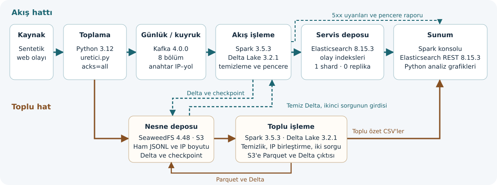
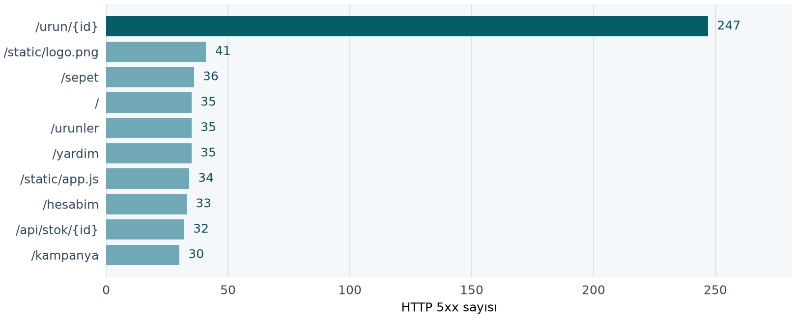

# Web sunucu log analizi

**BSM461 · Şube 1A · B201210555**

Koray Temizkan · Yüksel · Ali

<!-- sayfa -->

# Kafka bölümleme ve uyarı

**2–5. dakika · İki karar**

| Karar | Dayanak |
|---|---|
| Sekiz Kafka bölümü ve IP–yol anahtarı | 50.000 olaylık benzetimde en dolu bölüm / ortalama oranı IP ile **1,7202**, yol ile **2,0685**, IP–yol ile **1,3238**. |
| 20 saniyelik pencere ve 10 dakika watermark | Pencere güncellenirken uyarı üretir. 50 sentetik `503` için Kafka onayından konsol uyarısına **21,863 saniye** geçti. Hedef **30 saniye**. |

Tepe yük **12.000 olay/s**. Beş saniyede 20.000 ofset okuma sınırı tepeyi karşılamak için yükseltilip yük altında sınanmalı.

<!-- sayfa -->

# Akışı çalışırken göster

**5–7. dakika · Canlı demo**

1. Yeni `demo` kimliğiyle Spark akışını `--goster` ve Elasticsearch çıkışıyla başlat.
2. İkinci terminalden B201210555 üreticisini çalıştır. Konsolda pencere ve rota güncellemelerini göster.
3. Aynı deneyin Elasticsearch indeksinde 5xx aramasını ve rota toplamasını çalıştır.

**Kayıtlı demo çıktısı** · `5xx eşiği · 50/50 · %100`

Kanıtlar `kanit/uyari-akis.log`, `kanit/es-arama.json` ve `kanit/es-toplama.json` dosyalarında.

<!-- sayfa -->

# Yazarken Spark kesilirse

**7–9. dakika · Yüksel’in canlı kesinti deneyi**

| Hedef | Yazma başlamadan | `Ctrl+C` sonrasında |
|---|---|---|
| Delta | Sürüm 0 · 1.000 satır | **Sürüm 0 · 1.000 satır okunabildi** |
| Normal Parquet | 1.000 satır | **`UNABLE_TO_INFER_SCHEMA`** |

3.010.000 ham satırlık kaynaktan üzerine yazım başlatıldı. Başarılı Delta commit’i kaldı.

Diğer kırılma noktaları akış yığını birikmesi ve tek Kafka broker kesintisi.

<!-- sayfa -->

# En çok 5xx hangi rotada?

**9–10. dakika · Yedi günlük Spark pilotu**

`/urun/{id}` rotasında **3.768 isteğin 247’si** HTTP 5xx döndürdü. Rota, hata adedinde ilk sıradaydı.

<!-- sayfa -->

# Sorular

**10–12. dakika**

| Senaryo hedefi | Yerel kanıt |
|---|---|
| 30 saniyede uyarı | 21,863 saniye, bir koşu |
| Servis p99 ≤ 2.000 ms | Arama 8,082 ms, toplama 15,653 ms, her biri 100 tekrar |
| 30 günlük ham saklama | Yaklaşık 690 GB hesaplanan ham JSONL hacmi |

[Proje deposu](https://github.com/KorayTemizkan/BSM461_Proje_1A_B201210555)
